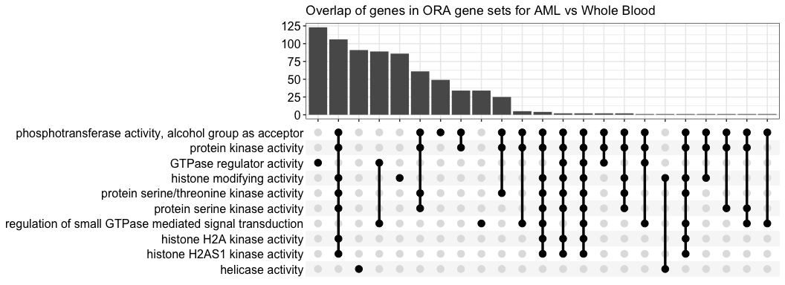

# Biology vignette for splice compendium
celiang@ucsc.edu
2026-11-03

This notebook takes Wilcoxon test statistics and dPSI values for query
and reference groups chosen in `scripts/06-diffsplice_calculation.R` as
input. After filtering for splice events with user-defined padj and dPSI
thresholds, this notebook performs over-representation analysis (ORA) on
the parent genes of the filtered splice events.

Caveats:

- The input to this notebook is currently the AML (stranded) vs. Whole
  Blood (unstranded) diffsplice results so doesn’t reflect the
  biological comparison we want to make for the manuscript.

## Setup

Load libraries

``` r
library(ggplot2)
library(msigdbr)
library(clusterProfiler)
```

    clusterProfiler v4.14.6 Learn more at https://yulab-smu.top/contribution-knowledge-mining/

    Please cite:

    G Yu. Background bias in functional enrichment analysis: Insights from
    clusterProfiler. The Innovation Life. 2026, 4(1):100181


    Attaching package: 'clusterProfiler'

    The following object is masked from 'package:stats':

        filter

``` r
library(enrichplot)
```

    enrichplot v1.26.6 Learn more at https://yulab-smu.top/contribution-knowledge-mining/

    Please cite:

    Guangchuang Yu, Li-Gen Wang, and Qing-Yu He. ChIPseeker: an
    R/Bioconductor package for ChIP peak annotation, comparison and
    visualization. Bioinformatics. 2015, 31(14):2382-2383

Define directory and file paths

``` r
## directories
# repo root
repo_root <- rprojroot::find_root(rprojroot::is_git_root)

# test diffsplice results dir
test_dir <- file.path(repo_root, "test_files")

## files
# whole blood vs AML splice results with gene name, median PSI, diffsplice dpsi, and p-adj columns
diffsplice_results_file <- file.path(test_dir, "diffsplice_Whole_Blood_vs_AML.tsv")

# output ORA results
out_file <- file.path(test_dir,  "ora_test.tsv")
```

Read in files

``` r
diffsplice_results <- readr::read_tsv(diffsplice_results_file) 
```

    Rows: 440178 Columns: 7
    ── Column specification ────────────────────────────────────────────────────────
    Delimiter: "\t"
    chr (2): pos_id, gene_names
    dbl (5): p, p_adj, median_PSI_query, median_PSI_ref, dPSI

    ℹ Use `spec()` to retrieve the full column specification for this data.
    ℹ Specify the column types or set `show_col_types = FALSE` to quiet this message.

## ORA

### Retrieve gene lists from splice results for ORA

Background genes (`detected_genes`) are all genes with non-NA (numeric)
PSI values quantified for at least min_samples in the reference and
query groups. In the test data used here, min_samples was 5.

``` r
detected_genes <- diffsplice_results |>
  # remove NA p values, as they are present in the diffsplice data frame
  dplyr::filter(!is.na(p_adj)) |>
  # extract gene names column for ORA
  dplyr::pull(gene_names) |>
  # take unique set of parent genes
  unique()
```

Filter for differential splicing results within padj and significance
thresholds and obtain the diffsplice gene list

``` r
# filter for significant diffsplice evennts
filtered_diffsplice_results <- diffsplice_results |>
  dplyr::filter(
    p_adj < params$padj,
    abs(dPSI) > params$dpsi
  ) |>
  # rank significant diff splice events by abs(dPSI)
  dplyr::arrange(desc(abs(dPSI)))

# obtain vector of significant diffsplice parent genes
diffsplice_genes <- unique(filtered_diffsplice_results$gene_names)
```

### ORA on significantly differentially spliced genes

Using the BP gene set, `pvaluecutoff` 0.05, and `qvaluecutoff` 0.05,
only 1 gene set is returned as enriched in splicing
`(regulation of small GTPase mediated signal transduction`).

Using ALL gene sets, 21 are returned with these thresholds. The AML
vs. Whole Blood comparison is one of the ref/query pairs that had the
most samples, so I will leave the gene sets as ALL here since I now
expect most ref/query pairs to return very few significantly
overrepresented genes.

``` r
go_enrich <- enrichGO(gene = diffsplice_genes,
                      universe = detected_genes,
                      OrgDb = "org.Hs.eg.db",
                      keyType = 'SYMBOL',
                      readable = T,
                      ont = c("ALL"),
                      pvalueCutoff = 0.05,
                      qvalueCutoff = 0.05)
```

## Plot ORA results

Plot overlapping genes in each gene set with an upset plot

``` r
upsetplot(go_enrich) +
  ggtitle("Overlap of genes in ORA gene sets for AML vs Whole Blood")
```

    Warning: `aes_()` was deprecated in ggplot2 3.0.0.
    ℹ Please use tidy evaluation idioms with `aes()`
    ℹ The deprecated feature was likely used in the enrichplot package.
      Please report the issue at
      <https://github.com/GuangchuangYu/enrichplot/issues>.

    Warning: Using `size` aesthetic for lines was deprecated in ggplot2 3.4.0.
    ℹ Please use `linewidth` instead.
    ℹ The deprecated feature was likely used in the ggupset package.
      Please report the issue at <https://github.com/const-ae/ggupset/issues>.



Plot gene set gene count and significance from ORA: dot plot of gene set
gene abundance (gene ratio) and ORA p values

``` r
dotplot(go_enrich)
```


## Write output to file

``` r
readr::write_tsv(as.data.frame(go_enrich), out_file)
```
