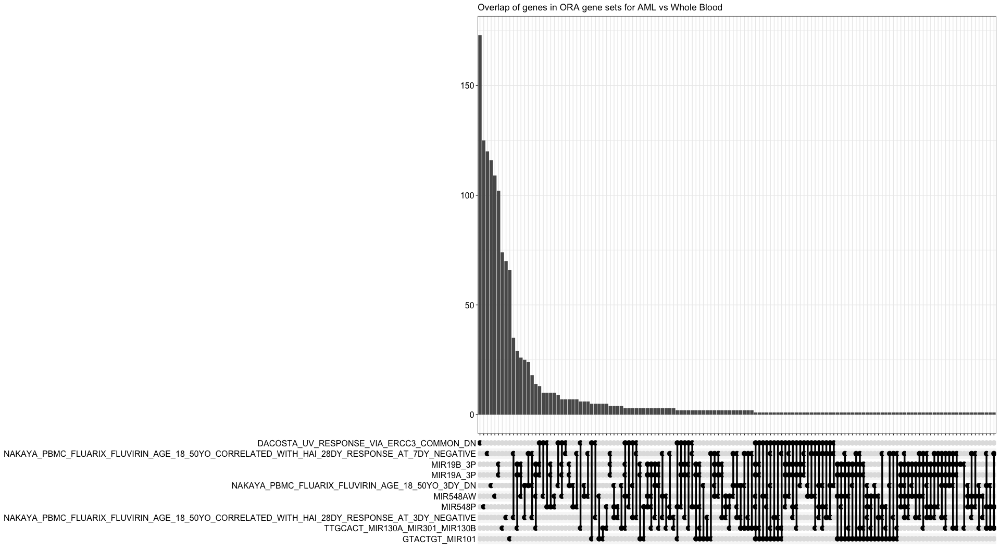
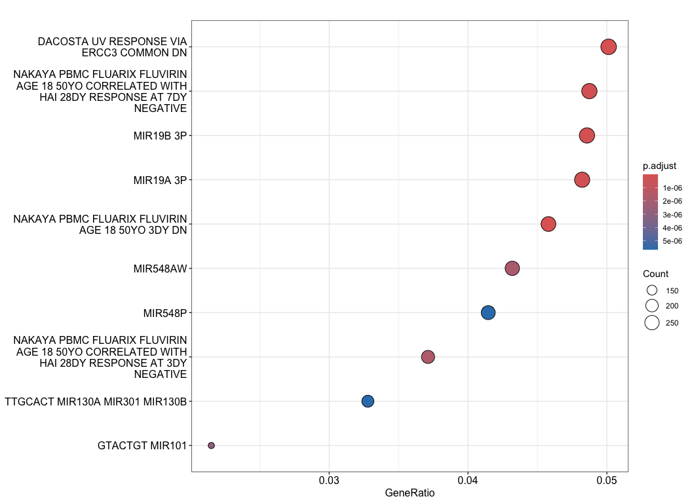

# Biology vignette for splice compendium
celiang@ucsc.edu
2026-11-04

This notebook takes Wilcoxon test statistics and dPSI values for query
and reference groups chosen in `scripts/06-diffsplice_calculation.R` as
input. After filtering for splice events with user-defined padj and dPSI
thresholds, this notebook performs over-representation analysis (ORA) on
the parent genes of the filtered splice events.

Caveats:

- The input to this notebook is currently the AML (stranded) vs. Whole
  Blood (unstranded) diffsplice results so doesn’t reflect the
  biological comparison we want to make for the manuscript.

## Setup

Load libraries

``` r
library(ggplot2)
library(msigdbr)
library(clusterProfiler)
```

    clusterProfiler v4.14.6 Learn more at https://yulab-smu.top/contribution-knowledge-mining/

    Please cite:

    Guangchuang Yu, Li-Gen Wang, Yanyan Han and Qing-Yu He.
    clusterProfiler: an R package for comparing biological themes among
    gene clusters. OMICS: A Journal of Integrative Biology. 2012,
    16(5):284-287


    Attaching package: 'clusterProfiler'

    The following object is masked from 'package:stats':

        filter

``` r
library(enrichplot)
```

    enrichplot v1.26.6 Learn more at https://yulab-smu.top/contribution-knowledge-mining/

    Please cite:

    G Yu. Thirteen years of clusterProfiler. The Innovation. 2024,
    5(6):100722

Define directory and file paths

``` r
## directories
# repo root
repo_root <- rprojroot::find_root(rprojroot::is_git_root)

## files
# whole blood vs AML splice results with gene name, median PSI, diffsplice dpsi, and p-adj columns
diffsplice_results_file <- file.path(repo_root, params$in_file)

# output ORA results
out_file <- file.path(repo_root, params$out_file)
```

Read in files

``` r
diffsplice_results <- readr::read_tsv(diffsplice_results_file) 
```

    Rows: 440178 Columns: 7
    ── Column specification ────────────────────────────────────────────────────────
    Delimiter: "\t"
    chr (2): pos_id, gene_names
    dbl (5): p, p_adj, median_PSI_query, median_PSI_ref, dPSI

    ℹ Use `spec()` to retrieve the full column specification for this data.
    ℹ Specify the column types or set `show_col_types = FALSE` to quiet this message.

## ORA

Define gene sets by gs_id (Systematic name in msigdb website) M15250
GOBP_MRNA_CIS_SPLICING_VIA_SPLICEOSOME M22142
GOBP_MRNA_3_SPLICE_SITE_RECOGNITION M10881
GOBP_ALTERNATIVE_MRNA_SPLICING_VIA_SPLICEOSOME M22144
GOBP_MRNA_5_SPLICE_SITE_RECOGNITION M15250
GOBP_MRNA_CIS_SPLICING_VIA_SPLICEOSOME M1426
GOBP_MRNA_SPLICE_SITE_RECOGNITION M50471
GOBP_POSITIVE_REGULATION_OF_MRNA_SPLICING_VIA_SPLICEOSOME M14810
GOBP_REGULATION_OF_MRNA_SPLICING_VIA_SPLICEOSOME M9878
GOBP_SPLICEOSOMAL_COMPLEX_ASSEMBLY M22143
GOBP_SPLICEOSOMAL_CONFORMATIONAL_CHANGES_TO_GENERATE_CATALYTIC_CONFORMATION
M16609 GOBP_SPLICEOSOMAL_SNRNP_ASSEMBLY M12504
GOBP_SPLICEOSOMAL_TRI_SNRNP_COMPLEX_ASSEMBLY M50333
GOBP_TRNA_TYPE_INTRON_SPLICE_SITE_RECOGNITION_AND_CLEAVAGE M45251
GOBP_U2_TYPE_PRESPLICEOSOME_ASSEMBLY M25907
GOCC_CATALYTIC_STEP_1_SPLICEOSOME M17484
GOCC_CATALYTIC_STEP_2_SPLICEOSOME M25908
GOCC_POST_MRNA_RELEASE_SPLICEOSOMAL_COMPLEX M17178
GOCC_PRECATALYTIC_SPLICEOSOME M17478 GOCC_PRESPLICEOSOME M17545
GOCC_SPLICEOSOMAL_COMPLEX M17317 GOCC_SPLICEOSOMAL_TRI_SNRNP_COMPLEX
M50617 GOCC_U12_TYPE_CATALYTIC_STEP_2_SPLICEOSOME M50616
GOCC_U12_TYPE_PRECATALYTIC_SPLICEOSOME M19132
GOCC_U12_TYPE_SPLICEOSOMAL_COMPLEX M25906
GOCC_U2_TYPE_CATALYTIC_STEP_2_SPLICEOSOME M50614
GOCC_U2_TYPE_PRECATALYTIC_SPLICEOSOME M17071
GOCC_U2_TYPE_SPLICEOSOMAL_COMPLEX M26523
GOMF_PRE_MRNA_3_SPLICE_SITE_BINDING M51268
KEGG_MEDICUS_REFERENCE_SPLICEOSOME_ACTIVATION M51267
KEGG_MEDICUS_REFERENCE_SPLICEOSOME_ASSEMBLY_B_COMPLEX_FORMATION M51265
KEGG_MEDICUS_REFERENCE_SPLICEOSOME_ASSEMBLY_E_AND_A_COMPLEX_FORMATION
M51269 KEGG_MEDICUS_REFERENCE_SPLICEOSOME_CATALYSIS_BRANCHING M51288
KEGG_MEDICUS_REFERENCE_SPLICEOSOME_CATALYSIS_EXON_LIGATION M51289
KEGG_MEDICUS_REFERENCE_SPLICEOSOME_DISASSEMBLY M2044 KEGG_SPLICEOSOME

Cancer gene sets

C4 (computational gene sets, 1006 gene sets) - contains: 3CA (Curated
Cancer Cell Atlas gene sets, 148 gene sets) CGN (cancer gene
neighborhoods, 427 gene sets) CM (cancer modules, 431 gene sets)

C6: Oncogenic Signature Gene Sets

HALLMARK_EPITHELIAL_MESENCHYMAL_TRANSITION

HALLMARK_MYOGENESIS (relevant to blood) – maybe just all of Hallmark

``` r
# these are just everything with "splice" in the name for now
splice_ids <- c(
  "M15250",
  "M22142",
  "M10881",
  "M22144",
  "M15250",
  "M1426",
  "M50471",
  "M14810",
  "M9878",
  "M22143",
  "M16609",
  "M12504",
  "M50333",
  "M45251",
  "M25907",
  "M17484",
  "M25908",
  "M17178",
  "M17478",
  "M17545",
  "M17317",
  "M50617",
  "M50616",
  "M19132",
  "M25906",
  "M50614",
  "M17071",
  "M26523",
  "M51268",
  "M51267",
  "M51265",
  "M51269",
  "M51288",
  "M51289",
  "M2044"
)
```

Obtain msigdb gene sets relevant to humans

``` r
hs_msigdb_df <- msigdbr(species = "Homo sapiens")
```

Filter for human msigdb gene sets with splicing involved

``` r
splice_hs_msigdb_df <- hs_msigdb_df |>
  dplyr::filter(gs_id %in% splice_ids)
```

### Retrieve gene lists from splice results for ORA

Background genes (`detected_genes`) are all genes with non-NA (numeric)
PSI values quantified for at least min_samples in the reference and
query groups. In the test data used here, min_samples was 5.

``` r
detected_genes <- diffsplice_results |>
  # remove NA p values, as they are present in the diffsplice data frame
  dplyr::filter(!is.na(p_adj)) |>
  # extract gene names column for ORA
  dplyr::pull(gene_names) |>
  # take unique set of parent genes
  unique()
```

Filter for differential splicing results within padj and significance
thresholds and obtain the diffsplice gene list

``` r
# filter for significant diffsplice evennts
filtered_diffsplice_results <- diffsplice_results |>
  dplyr::filter(
    p_adj < params$padj,
    abs(dPSI) > params$dpsi
  ) |>
  # rank significant diff splice events by abs(dPSI)
  dplyr::arrange(desc(abs(dPSI)))

# obtain vector of significant diffsplice parent genes
diffsplice_genes <- unique(filtered_diffsplice_results$gene_names)
```

### ORA on significantly differentially spliced genes

For a first pass, I am not filtering for specific gene sets and applying
a more stringent p filter. In an earlier iteration, I tried to perform
ORA on the splicing gene sets defined by `splice_ids`, but no set was
enriched even when `pvalueCutoff` = 1.

``` r
go_enrich <- enricher(
  gene = diffsplice_genes, 
  pvalueCutoff = 0.01,
  pAdjustMethod = "BH",
  universe = detected_genes,
  TERM2GENE = dplyr::select(
    hs_msigdb_df,
    gs_name,
    gene_symbol
  )
)
```

## Plot ORA results

Plot overlapping genes in each gene set with an upset plot

``` r
upsetplot(go_enrich) +
  ggtitle("Overlap of genes in ORA gene sets for AML vs Whole Blood")
```

    Warning: `aes_()` was deprecated in ggplot2 3.0.0.
    ℹ Please use tidy evaluation idioms with `aes()`
    ℹ The deprecated feature was likely used in the enrichplot package.
      Please report the issue at
      <https://github.com/GuangchuangYu/enrichplot/issues>.

    Warning: Using `size` aesthetic for lines was deprecated in ggplot2 3.4.0.
    ℹ Please use `linewidth` instead.
    ℹ The deprecated feature was likely used in the ggupset package.
      Please report the issue at <https://github.com/const-ae/ggupset/issues>.



Plot gene set gene count and significance from ORA: dot plot of gene set
gene abundance (gene ratio) and ORA p values

``` r
dotplot(go_enrich)
```



Gene sets to consider / genes to pull out

- Prioritize clinical relevance of gene sets or genes –\> look for gene
  sets that might be clinically relevant

- Going from enrichment to clinically relevant result using this
  analysis

## Write output to file

``` r
readr::write_tsv(as.data.frame(go_enrich), out_file)
```
