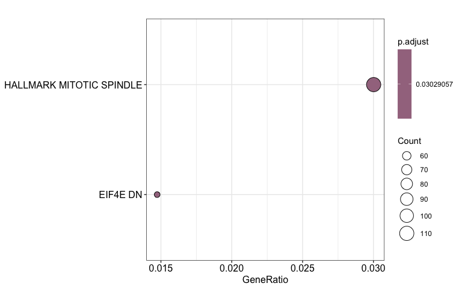

# Biology vignette for splice compendium
celiang@ucsc.edu
2026-11-05

This notebook takes Wilcoxon test statistics and dPSI values for query
and reference groups chosen in `scripts/06-diffsplice_calculation.R` as
input. After filtering for splice events with user-defined padj and dPSI
thresholds, this notebook performs over-representation analysis (ORA) on
the parent genes of the filtered splice events.

Caveats:

- The input to this notebook is currently the AML (stranded) vs. Whole
  Blood (unstranded) diffsplice results so doesn’t reflect the
  biological comparison we want to make for the manuscript.

Gene sets used in this analysis fall under two categories:

Category 1: Genes documented to be differentially spliced when splicing
factors are mutated in blood cancers

- Custom gene set: u2af1_leuk_diffsplice_genes - list of 16 genes
  differentially spliced in U2AF1 mutant vs. WT cells in AMLCG, Beat AML
  datasets, Okeyo-Owuor et al. (Table S14 of
  [Bamopoulos](https://www.nature.com/articles/s41375-020-0839-4#auth-Stefanos_A_-Bamopoulos-Aff1-Aff2)
  et al. 2020)
- msigDB gene sets: GOBP_REGULATION_OF_MRNA_SPLICING_VIA_SPLICEOSOME
  (M14810), GOBP_ALTERNATIVE_MRNA_SPLICING_VIA_SPLICEOSOME (M10881)

Category 2: Gene sets with clinical/oncogenic relevance

- Custom gene set:
  [treehouseDruggableGenes_2020-03_25.txt](https://github.com/UCSC-Treehouse/CKCC2/blob/adb997599358916e120f0118e8cffa2cd6bd9890/data/treehouseDruggableGenes_2020-03_25.txt#L4) -
  Treehouse list of 116 druggable genes used for patient outlier
  analysis
- msigDB gene sets: HALLMARK_EPITHELIAL_MESENCHYMAL_TRANSITION (M5930),
  HALLMARK_KRAS_SIGNALING_DN (M5956), HALLMARK_KRAS_SIGNALING_UP
  (M5953), HALLMARK_ANGIOGENESIS (M5944), HALLMARK_UV_RESPONSE_DN
  (M5942), HALLMARK_UV_RESPONSE_UP (M5941)

## Setup

Load libraries

``` r
library(ggplot2)
library(msigdbr)
library(clusterProfiler)
```

    clusterProfiler v4.14.6 Learn more at https://yulab-smu.top/contribution-knowledge-mining/

    Please cite:

    Guangchuang Yu, Li-Gen Wang, Yanyan Han and Qing-Yu He.
    clusterProfiler: an R package for comparing biological themes among
    gene clusters. OMICS: A Journal of Integrative Biology. 2012,
    16(5):284-287


    Attaching package: 'clusterProfiler'

    The following object is masked from 'package:stats':

        filter

``` r
library(enrichplot)
```

    enrichplot v1.26.6 Learn more at https://yulab-smu.top/contribution-knowledge-mining/

    Please cite:

    Guangchuang Yu. Using meshes for MeSH term enrichment and semantic
    analyses. Bioinformatics. 2018, 34(21):3766-3767,
    doi:10.1093/bioinformatics/bty410

Define directory and file paths

``` r
## directories
# repo root
repo_root <- rprojroot::find_root(rprojroot::is_git_root)
# gene sets
gene_set_dir <- file.path(repo_root, "gene_sets")

## files ##
# whole blood vs AML splice results with gene name, median PSI, diffsplice dpsi, and p-adj columns
diffsplice_results_file <- file.path(repo_root, params$in_file)

# gene sets for ORA
treehouse_druggable_genes_file <- file.path(gene_set_dir, "treehouseDruggableGenes_2020-03_25.txt")

# output files
out_ora_file <- file.path(repo_root, params$out_ora_file)
out_sig_diffsplice_file <- file.path(repo_root, params$out_sig_diffsplice_file)
```

Read in files

``` r
diffsplice_results <- readr::read_tsv(diffsplice_results_file) 
```

    Rows: 440178 Columns: 7
    ── Column specification ────────────────────────────────────────────────────────
    Delimiter: "\t"
    chr (2): pos_id, gene_names
    dbl (5): p, p_adj, median_PSI_query, median_PSI_ref, dPSI

    ℹ Use `spec()` to retrieve the full column specification for this data.
    ℹ Specify the column types or set `show_col_types = FALSE` to quiet this message.

``` r
th_druggable_genes <- readr::read_tsv(treehouse_druggable_genes_file)
```

    Rows: 115 Columns: 2
    ── Column specification ────────────────────────────────────────────────────────
    Delimiter: "\t"
    chr (2): gene, group

    ℹ Use `spec()` to retrieve the full column specification for this data.
    ℹ Specify the column types or set `show_col_types = FALSE` to quiet this message.

## ORA

Obtain msigdb gene sets relevant to humans

``` r
hs_msigdb_df <- msigdbr(species = "Homo sapiens")
```

Define list of genes for custom gene sets and lists of msigDB gene sets
of interest

``` r
# define custom splice gene list
u2af1_leuk_diffsplice_genes <- c(
  "ABI1",
  "CLTA",
  "DEK",
  "GIT2",
  "HNRNPK",
  "HP1BP3",
  "ITCH",
  "MCM3",
  "NSMAF",
  "PCNXL4",
  "PLEKHM2",
  "PMM2",
  "PPP6R3",
  "RP3-477O4.14",
  "SET",
  "SWI5"
)

# define treehouse druggable gene list
druggable_genes <-th_druggable_genes |> 
  dplyr::pull(gene)

# define list of splice-relevant msigdb gene sets
msigdb_splice_sets <- c("M14810", "M10881")
msigdb_cancer_sets <- c("M5930", "M5956", "M5953", "M5944", "M5942", "M5941")
```

### Retrieve gene lists from splice results for ORA

Background genes (`detected_genes`) are all genes with non-NA (numeric)
PSI values quantified for at least min_samples in the reference and
query groups. In the test data used here, min_samples is 5.

``` r
detected_genes <- diffsplice_results |>
  # remove NA p values, as they are present in the diffsplice data frame
  dplyr::filter(!is.na(p_adj)) |>
  # extract gene names column for ORA
  dplyr::pull(gene_names) |>
  # take unique set of parent genes
  unique()
```

Filter for differential splicing results within padj and significance
thresholds and obtain the diffsplice gene list

``` r
# filter for significant diffsplice events
filtered_diffsplice_results <- diffsplice_results |>
  dplyr::filter(
    p_adj < params$padj,
    abs(dPSI) > params$dpsi
  ) |>
  # rank significant diff splice events by abs(dPSI)
  dplyr::arrange(desc(abs(dPSI)))

# obtain vector of significant diffsplice parent genes
diffsplice_genes <- unique(filtered_diffsplice_results$gene_names)
```

### Pull gene sets from human msigdb database

``` r
colnames(hs_msigdb_df)
```

     [1] "gene_symbol"        "ncbi_gene"          "ensembl_gene"      
     [4] "db_gene_symbol"     "db_ncbi_gene"       "db_ensembl_gene"   
     [7] "source_gene"        "gs_id"              "gs_name"           
    [10] "gs_collection"      "gs_subcollection"   "gs_collection_name"
    [13] "gs_description"     "gs_source_species"  "gs_pmid"           
    [16] "gs_geoid"           "gs_exact_source"    "gs_url"            
    [19] "db_version"         "db_target_species" 

``` r
filtered_hs_msigdb <- hs_msigdb_df |>
  dplyr::filter(
    gs_id %in% as.list(msigdb_splice_sets, msigdb_cancer_sets) 
  )

hallmark_oncosig_msigdb <- hs_msigdb_df |>
  dplyr::filter(
    gs_collection_name %in% c("Hallmark", "Oncogenic Signature") 
  )
```

### ORA on significantly differentially spliced genes

First, try to perform ORA on the filtered msigdb gene sets. Nothing
comes up as significantly enriched, even when using no p value filter.

``` r
targeted_ora_result <- enricher(
  gene = diffsplice_genes, 
  pvalueCutoff = 0.05,
  pAdjustMethod = "BH",
  universe = detected_genes,
  TERM2GENE = dplyr::select(
    filtered_hs_msigdb,
    gs_name,
    gene_symbol
  )
)

# check if anything comes up
targeted_ora_result |> as.data.frame()
```

| ID | Description | GeneRatio | BgRatio | RichFactor | FoldEnrichment | zScore | pvalue | p.adjust | qvalue | geneID | Count |
|:---|:---|:---|:---|---:|---:|---:|---:|---:|---:|:---|---:|

Try ORA on Hallmark and Oncogenic Signatures gene sets only

``` r
ora_result <- enricher(
  gene = diffsplice_genes, 
  pvalueCutoff = 0.05,
  pAdjustMethod = "BH",
  universe = detected_genes,
  TERM2GENE = dplyr::select(
    hallmark_oncosig_msigdb,
    gs_name,
    gene_symbol
  )
)
```

``` r
as.data.frame(ora_result) |>
  head()
```

|  | ID | Description | GeneRatio | BgRatio | RichFactor | FoldEnrichment | zScore | pvalue | p.adjust | qvalue | geneID | Count |
|:---|:---|:---|:---|:---|---:|---:|---:|---:|---:|---:|:---|---:|
| EIF4E_DN | EIF4E_DN | EIF4E_DN | 54/3665 | 77/7479 | 0.7012987 | 1.431109 | 3.727322 | 0.0001299 | 0.0302906 | 0.0296073 | ALPK1/CD55/GFOD3P/DENND2D/FRMD4B/PARP8/CLINT1/DCTN4/OFD1/SH3YL1/TPD52/SEMA4D/FAS/NCOA6/NCOA7/SVIL/SIK3/TNIP1/WASHC5/NPEPPS/WDFY3/MAP3K5/TP53BP1/TRIP11/RCBTB2/ARID4B/CERT1/TBCK/TP53BP2/UPF2/SLC46A3/VPS13C/ADAM9/USP47/ANGPTL4/FNDC3B/CLTC/SCAMP1/PHIP/CCDC174/LRBA/KLHL21/PRMT9/CASP10/LMO7/OGA/FHIP2A/PRRC2C/MYO10/STAT5A/MCPH1/C3/KPNA4/NEDD4L | 54 |
| HALLMARK_MITOTIC_SPINDLE | HALLMARK_MITOTIC_SPINDLE | HALLMARK_MITOTIC_SPINDLE | 110/3665 | 177/7479 | 0.6214689 | 1.268204 | 3.539726 | 0.0002545 | 0.0302906 | 0.0296073 | DOCK2/HDAC6/MARK4/SEPTIN9/NEDD9/ARHGEF2/RAB3GAP1/PXN/ARHGEF11/CDC42/PRC1/LATS1/ATG4B/CEP72/KLC1/CDK5RAP2/PDLIM5/CLIP1/STAU1/RASA2/KIF1B/RACGAP1/CNTROB/FGD4/CNTRL/NF1/RASA1/CDC27/ARFGEF1/TUBD1/MAP3K11/TSC1/TAOK2/ARAP3/NOTCH2/NET1/CSNK1D/ABI1/SSH2/RFC1/TUBGCP2/WASF1/KIF23/ARHGAP5/TRIO/PLK1/LMNB1/ABR/NCK2/AURKA/ARHGAP4/ECT2/PCM1/RAPGEF6/SUN2/KIF22/CLASP1/PAFAH1B1/DLG1/MYO9B/ARHGEF3/BCL2L11/KIF3B/TUBA4A/NIN/PPP4R2/EPB41/LRPPRC/SOS1/KNTC1/SPTAN1/EZR/ARHGEF7/ANLN/ALS2/SMC4/CCDC88A/ARHGAP27/GSN/CD2AP/BIN1/PKD2/AKAP13/TLK1/RABGAP1/TBCD/SASS6/CKAP5/CEP192/TOP2A/ARHGEF12/CEP57/RICTOR/ITSN1/ABL1/PCGF5/ACTN4/KIF15/FLNA/FLNB/ESPL1/YWHAE/CENPF/ROCK1/MYH9/TUBGCP5/CEP250/EPB41L2/NUMA1/VCL | 110 |

## Plot ORA results

Plot overlapping genes in each gene set with an upset plot

``` r
upsetplot(ora_result, n = 10) +
  ggtitle("Overlap of genes in ORA gene sets for AML vs Whole Blood")
```

    Warning: `aes_()` was deprecated in ggplot2 3.0.0.
    ℹ Please use tidy evaluation idioms with `aes()`
    ℹ The deprecated feature was likely used in the enrichplot package.
      Please report the issue at
      <https://github.com/GuangchuangYu/enrichplot/issues>.

    Warning: Using `size` aesthetic for lines was deprecated in ggplot2 3.4.0.
    ℹ Please use `linewidth` instead.
    ℹ The deprecated feature was likely used in the ggupset package.
      Please report the issue at <https://github.com/const-ae/ggupset/issues>.

    `geom_line()`: Each group consists of only one observation.
    ℹ Do you need to adjust the group aesthetic?
    `geom_line()`: Each group consists of only one observation.
    ℹ Do you need to adjust the group aesthetic?

<div id="fig-upset-plot">


Figure 1

</div>

Plot gene set gene count and significance from ORA: dot plot of gene set
gene abundance (gene ratio) and ORA p values

``` r
dotplot(ora_result)
```

<div id="fig-dot-plot">



Figure 2

</div>

## Write outputs to file

``` r
readr::write_tsv(as.data.frame(ora_result), out_ora_file)
readr::write_tsv(diffsplice_results, out_sig_diffsplice_file)
```
